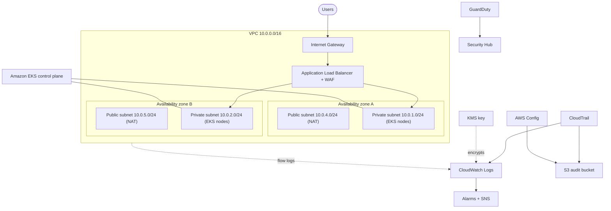

# EKS on AWS with Terraform: secure multi-AZ platform


> **Status:** infrastructure as code, validated in CI with `terraform validate`, TFLint and Checkov. It has not been deployed to an AWS account.

## Architecture



## What it provisions

| Area | AWS services |
|---|---|
| Network | VPC, public and private subnets across 2 AZs, internet gateway, NAT, S3 gateway endpoint |
| Network security | Dedicated network ACLs, locked-down default security group, private worker nodes |
| Compute | EKS, managed node group on EC2 with IMDSv2, encrypted EBS, SSM access |
| Ingress | ALB created by the AWS Load Balancer Controller, WAFv2 web ACL |
| Identity | Least-privilege IAM roles for service accounts (IRSA) |
| Encryption | KMS key with rotation, EKS secrets encryption, encrypted S3 and log groups |
| Logging | VPC Flow Logs, CloudTrail, EKS control plane logs, CloudWatch Logs |
| Auditing and detection | AWS Config rules, GuardDuty, Security Hub, CloudWatch alarms and SNS |
| Registry | ECR with scan on push and immutable tags |
| State | S3 remote state with native locking (bootstrap stack) |

## Security design

- Worker nodes run only in private subnets and have no SSH. Shell access uses SSM Session Manager.
- Pods get AWS permissions through IRSA instead of the node role.
- Network ACLs and security groups add two layers of network control.
- Every log source is encrypted and retained, and alarms watch for root usage, denied API calls and console logins without MFA.
- Decisions and accepted trade-offs are listed in [docs/security-decisions.md](docs/security-decisions.md).

## Repository layout

- `bootstrap/` creates the S3 bucket for Terraform state.
- `infra/` contains the platform: network, EKS, security and monitoring.
- `k8s/` contains a sample app and Ingress.
- `.github/workflows/ci.yml` runs fmt, validate, TFLint and Checkov.

## Local checks

```bash
terraform fmt -check -recursive
(cd infra && terraform init -backend=false && terraform validate)
tflint --chdir=infra --config="$PWD/.tflint.hcl"
checkov --config-file .checkov.yaml
```

## Cost

Not measured yet. An estimate will be added with the deployment guide.

## Roadmap

- Deployment guide and a measured cost estimate
- ArgoCD for GitOps delivery
- GitHub OIDC role so CI can run plans without stored keys
- ACM certificate and Route 53 record for HTTPS
